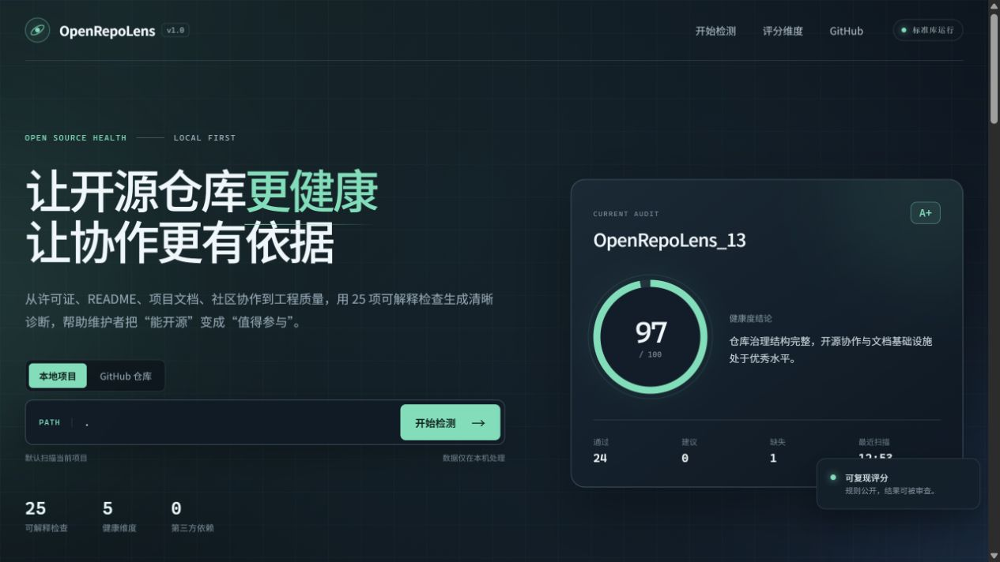

# OpenRepoLens_13

> 一个零第三方依赖、可解释、可本地运行的开源仓库健康度检测工具。

[](https://github.com/learngit13/OpenRepoLens_13/actions/workflows/tests.yml)
[](LICENSE)
[](pyproject.toml)



## 项目简介

OpenRepoLens 面向准备开源或正在维护开源项目的学生与个人开发者。它从许可证、README、项目文档、开放协作和工程质量五个维度执行 25 项检查，输出 100 分制健康度、证据说明与优先改进建议。

很多项目已经有代码，却缺少许可证、安装说明、贡献指南或自动化测试，导致外部参与者无法判断项目是否可信、如何运行、怎样反馈。OpenRepoLens 把这些容易被忽略的基础工作转化为可重复执行的检查，使开放式协作有明确的改进起点。

## 核心功能

- **五维健康画像**：许可证 15 分、README 25 分、项目文档 20 分、开放协作 20 分、工程质量 20 分。
- **可解释评分**：每项检查展示得分、最高分、检查证据和修复建议，不只给出单一结论。
- **本地与远程扫描**：可直接检查本地仓库，也可通过 GitHub REST API 检查公开仓库。
- **零依赖运行**：后端只使用 Python 标准库，前端不依赖构建工具或外部 CDN。
- **可视化面板**：提供健康度总览、分类进度条、检查明细筛选和优先改进清单。
- **CLI 报告**：支持终端文本、Markdown 与 JSON 三种输出，便于接入其他流程。

## 快速开始

### 环境要求

- Python 3.10 或更高版本
- Git（仅远程扫描时建议安装，本项目本身不强制依赖 Git 命令）

### 获取项目

```bash
git clone https://github.com/learngit13/OpenRepoLens_13.git
cd OpenRepoLens_13
```

### 启动可视化面板

```bash
python -m openrepolens serve --open
```

默认地址为 <http://127.0.0.1:8765>。页面打开后会自动扫描当前项目，也可以在输入框中填写其他本地目录。

### 命令行扫描

扫描当前目录：

```bash
python -m openrepolens scan --path .
```

输出 Markdown 或 JSON：

```bash
python -m openrepolens scan --path . --markdown
python -m openrepolens scan --path . --json
```

扫描公开 GitHub 仓库：

```bash
python -m openrepolens scan --url https://github.com/learngit13/OpenRepoLens_13
```

如需提高 GitHub API 的访问额度，可以设置只读令牌：

```bash
export GITHUB_TOKEN=your_token_here
```

## 评分规则

| 维度 | 分值 | 主要检查内容 |
| --- | ---: | --- |
| 许可证 | 15 | LICENSE 是否存在、是否可识别为常见 SPDX 许可证 |
| README | 25 | 内容完整度、安装步骤、功能、截图或徽章、社区与反馈入口 |
| 项目文档 | 20 | CONTRIBUTING、CODE_OF_CONDUCT、SECURITY、docs/、CHANGELOG |
| 开放协作 | 20 | Issue 模板、PR 模板、路线图、社区说明、维护者信息 |
| 工程质量 | 20 | 测试、CI、项目元数据、忽略规则、静态检查、可执行入口 |

完整规则见 [docs/scoring.md](docs/scoring.md)。评分规则保持公开，任何检查结果都可以在源码中找到对应实现。

## 项目结构

```text
OpenRepoLens_13/
├── openrepolens/          # 扫描器、评分规则、CLI 与本地 Web 服务
├── web/                   # 无构建依赖的单页可视化面板
├── tests/                 # 标准库 unittest 测试
├── docs/                  # 架构、评分、使用与社区文档
├── .github/               # Issue 模板、PR 模板与 CI 工作流
├── LICENSE                # MIT 许可证
└── pyproject.toml         # 项目元数据与入口声明
```

系统设计说明见 [docs/architecture.md](docs/architecture.md)，本地和远程扫描示例见 [docs/usage.md](docs/usage.md)。

## 开发与测试

项目不需要安装第三方包即可运行。执行全部测试：

```bash
python -m unittest discover -s tests -v
```

可选地检查代码风格：

```bash
ruff check .
```

## 参与贡献

欢迎通过 Issue 报告缺陷、提出功能建议，或通过 Pull Request 改进文档和代码。提交前请阅读 [CONTRIBUTING.md](CONTRIBUTING.md) 与 [CODE_OF_CONDUCT.md](CODE_OF_CONDUCT.md)。安全问题请按照 [SECURITY.md](SECURITY.md) 的说明私下报告。

## 路线图

- [x] 完成五维评分引擎与 25 项基础检查
- [x] 提供本地可视化面板与 CLI 报告
- [x] 支持公开 GitHub 仓库远程扫描
- [ ] 增加 HTML 报告导出和 PDF 附件
- [ ] 增加可配置评分模板与忽略规则
- [ ] 采集多仓库趋势并生成对比视图

## 维护者

- 项目维护者：郑骞欢（learngit13）
- 课程：成都信息工程大学《开源文化运动》
- 反馈入口：<https://github.com/learngit13/OpenRepoLens_13/issues>

## 许可证

本项目采用 [MIT License](LICENSE)。你可以自由使用、修改、分发，但需要保留版权与许可声明。

